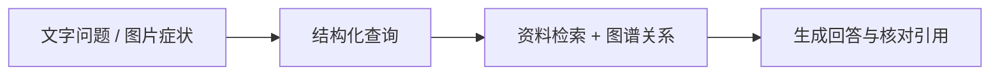

# AgriGraph Evidence QA

用文字或图片查找番茄、水稻病虫害知识。AgriGraph 将症状描述、资料检索和知识图谱连接起来，生成回答并记录依据，支持继续追问和关系查询。

[运行指南](docs/runbook.md) · [离线案例](examples/evidence-case/README.md) · [系统架构](docs/architecture.md)

## 可以怎么用

| 入口 | 操作示例 | 查看什么 |
| --- | --- | --- |
| 农业问答 | 选择番茄，提问“番茄灰霉病的发生条件是什么？” | 知识库回答和处理过程，可在当前会话继续追问 |
| 图片症状理解 | 上传作物图片，提取部位和可见症状 | 候选病虫害与知识库回答，也可携带症状进入问答 |
| 知识图谱 | 查找一个病虫害名称，展开关联节点 | 症状、病原、发生环境和防治关系，支持实体间路径查询 |

## 回答从哪里来



文字与图片共用检索流程：图片先提取作物、部位和可见症状，Elasticsearch 查找候选资料，Neo4j 补充关系，LangGraph 编排检索、生成和引用核验。症状与发生条件问题可配置 Reranker 调整候选顺序。

回答结果中保留陈述与证据 ID 的对应关系，核验后移除缺少支持的陈述。运行轨迹记录节点执行、检索模式和工具调用，便于检查一次回答是如何得到的。

## 先试一个离线案例

在已安装[后端依赖](docs/runbook.md#安装依赖)的 Conda `AiJava` 环境中，从仓库根目录运行：

```powershell
conda run --no-capture-output -n AiJava python scripts/demo/run-evidence-case.py
```

案例问题是“番茄叶片出现褐色斑点，应如何查找依据？”。脚本使用合成资料和模拟服务，无需 API Key 或 Docker，输出完整 JSON，可检查 `claims`、`citations`、`graphRelations` 和检索事件。

输入和结果见[案例说明](examples/evidence-case/README.md)与 [result.json](examples/evidence-case/result.json)。

## 启动应用

准备 Conda `AiJava`（Python 3.10）、Node.js 22+、pnpm 9.15.9 和 Docker。先获取项目：

```powershell
git clone https://github.com/xbzz1018/agrigraph.git
cd agrigraph
```

按[运行指南](docs/runbook.md)安装依赖、配置模型、启动依赖服务并导入公开知识数据。完成后，在仓库根目录启动应用：

```powershell
.\start-windows.bat
```

打开 <http://127.0.0.1:9627>，首次使用先注册账号，登录后进入「农业问答」，选择番茄或水稻，发送一个症状或发生条件问题。图片入口需要配置视觉模型。API 地址为 <http://127.0.0.1:8188>；停止应用使用 `stop-windows.bat`。

## 开发与数据

| 内容 | 入口 |
| --- | --- |
| 工作流与组件职责 | [系统架构](docs/architecture.md) |
| 项目实现与设计取舍 | [项目案例](docs/project-case.md) |
| 公开数据整理与图谱导入 | [脚本目录](scripts/README.md) |
| 评测数据与指标 | [评测说明](docs/evaluation/rag-evaluation.md) |

技术栈：Vue 3、FastAPI、LangGraph、Elasticsearch、Neo4j；SQLite 保存用户、会话与运行记录，Redis 和 PostgreSQL 支持会话记忆。

[MIT License](LICENSE) · [第三方来源](THIRD_PARTY_NOTICES.md)
